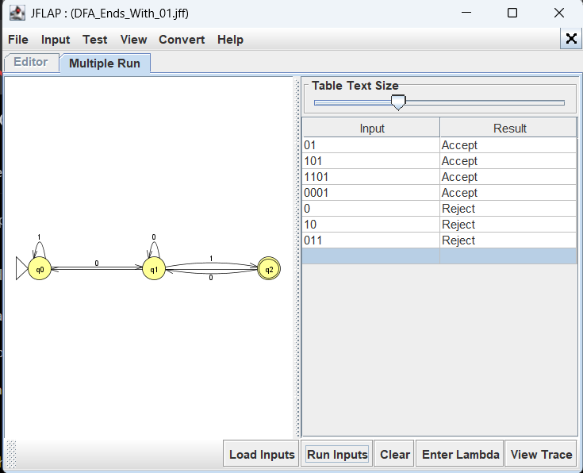
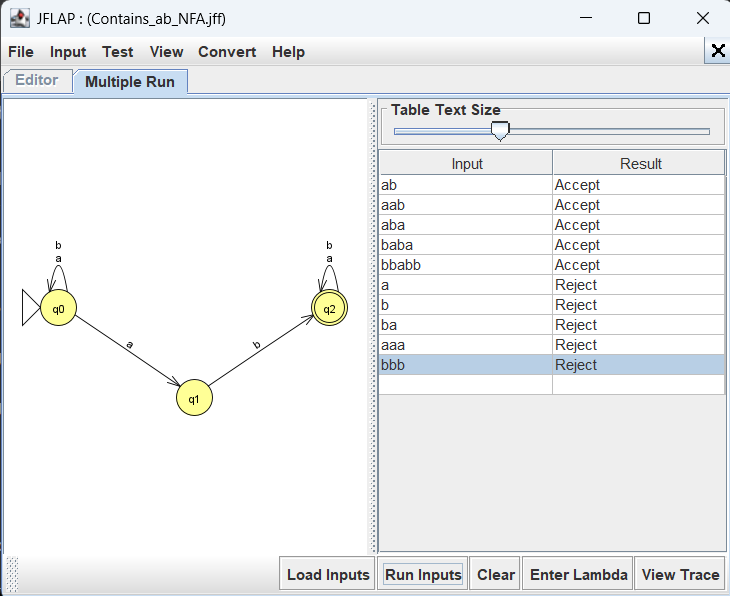
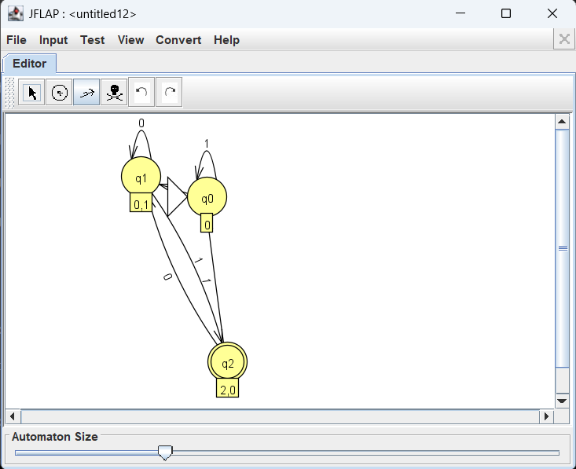
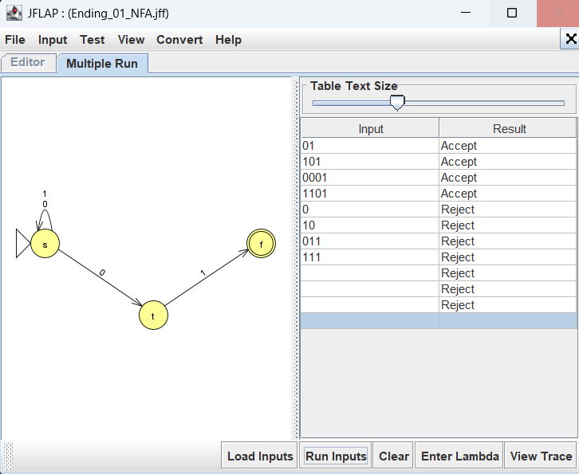
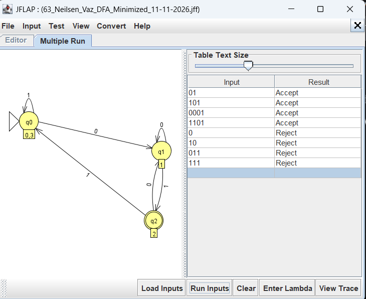
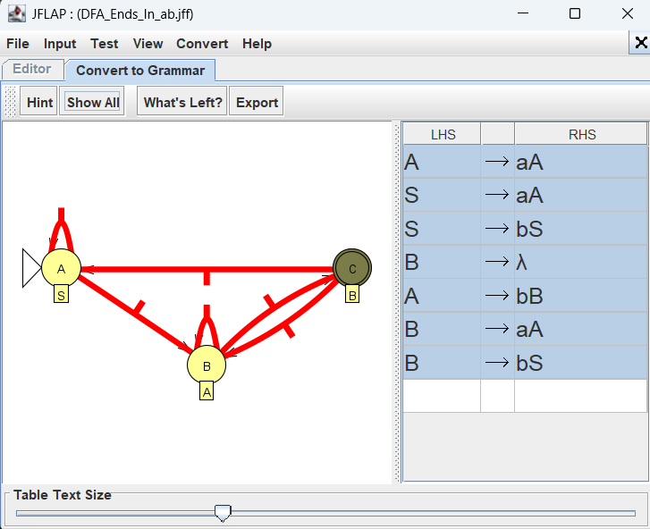

# Theory of Computer Science — JFLAP Self-Learning Assignment

**VESIT · Department of Computer Engineering · Academic Year 2026–2027**

## Student Details

| Field | Detail |
|---|---|
| **Name** | Neilsen Vaz |
| **Roll Number** | 63 |
| **Class & Division** | TE Computer Engineering, Division D12A |
| **Semester** | Semester V |
| **Academic Year** | 2026–2027 |
| **Subject** | Theory of Computer Science |
| **Subject Code** | 26CMPC51 |

---

## Index of Experiments

| Exp No. | Experiment Title | Model / Problem Statement | JFLAP File | Verification Status |
|:---:|---|---|---|:---:|
| 1 | **Deterministic Finite Automata (DFA)** | Design a DFA accepting binary strings ending in `01` | [`63_DFA_Ending_With_01.jff`](63_DFA_Ending_With_01.jff) | ✅ Verified |
| 2 | **Nondeterministic Finite Automata (NFA)** | Design an NFA accepting strings over `{a, b}` containing substring `ab` | [`63_NFA_Containing_ab.jff`](63_NFA_Containing_ab.jff) | ✅ Verified |
| 3 | **NFA to DFA Conversion** | Convert NFA for strings ending in `01` to equivalent DFA using subset construction | [`63_NFA_to_DFA_Conversion.jff`](63_NFA_to_DFA_Conversion.jff) | ✅ Verified (8/8 tests passed) |
| 4 | **DFA Minimization** | Minimize a 4-state DFA for strings ending in `01` to an equivalent 3-state DFA | [`63_DFA_Minimization.jff`](63_DFA_Minimization.jff) | ✅ Verified |
| 5 | **DFA to Regular Grammar Conversion** | Convert a DFA accepting strings over `{a, b}` ending in `ab` to an equivalent Right-Linear Grammar | [`63_DFA_to_Regular_Grammar.jff`](63_DFA_to_Regular_Grammar.jff) | ✅ Verified |

---

## Experiment 1: Deterministic Finite Automata (DFA)

### Objective
Design and simulate a Deterministic Finite Automaton (DFA) that accepts all binary strings over alphabet $\Sigma = \{0, 1\}$ that end with the substring `01`.

### Automaton Specification
- **States:** $Q = \{q_0, q_1, q_2\}$
- **Alphabet:** $\Sigma = \{0, 1\}$
- **Initial State:** $q_0$
- **Final State:** $F = \{q_2\}$
- **Transition Function:**
  - $\delta(q_0, 0) = q_1$, $\delta(q_0, 1) = q_0$
  - $\delta(q_1, 0) = q_1$, $\delta(q_1, 1) = q_2$
  - $\delta(q_2, 0) = q_1$, $\delta(q_2, 1) = q_0$

### Test Cases & Observed Results

| Input String | Expected Result | JFLAP Multiple Run Result | Status |
|:---:|:---:|:---:|:---:|
| `01` | Accept | Accept | Passed |
| `101` | Accept | Accept | Passed |
| `1101` | Accept | Accept | Passed |
| `0001` | Accept | Accept | Passed |
| `0` | Reject | Reject | Passed |
| `10` | Reject | Reject | Passed |
| `011` | Reject | Reject | Passed |

### JFLAP Screenshot


---

## Experiment 2: Nondeterministic Finite Automata (NFA)

### Objective
Design and simulate a Nondeterministic Finite Automaton (NFA) that accepts all strings over alphabet $\Sigma = \{a, b\}$ that contain the substring `ab`.

### Automaton Specification
- **States:** $Q = \{q_0, q_1, q_2\}$
- **Alphabet:** $\Sigma = \{a, b\}$
- **Initial State:** $q_0$
- **Final State:** $F = \{q_2\}$
- **Transitions:**
  - $\delta(q_0, a) = \{q_0, q_1\}$, $\delta(q_0, b) = \{q_0\}$ (nondeterministic branch on `a`)
  - $\delta(q_1, b) = \{q_2\}$
  - $\delta(q_2, a) = \{q_2\}$, $\delta(q_2, b) = \{q_2\}$

### Test Cases & Observed Results

| Input String | Expected Result | JFLAP Multiple Run Result | Status |
|:---:|:---:|:---:|:---:|
| `ab` | Accept | Accept | Passed |
| `aab` | Accept | Accept | Passed |
| `aba` | Accept | Accept | Passed |
| `baba` | Accept | Accept | Passed |
| `bbabb` | Accept | Accept | Passed |
| `a` | Reject | Reject | Passed |
| `b` | Reject | Reject | Passed |
| `ba` | Reject | Reject | Passed |
| `aaa` | Reject | Reject | Passed |
| `bbb` | Reject | Reject | Passed |

### JFLAP Screenshot


---

## Experiment 3: NFA to DFA Conversion

### Objective
Convert the given NFA accepting binary strings ending in `01` into an equivalent Deterministic Finite Automaton (DFA) using the Subset Construction algorithm in JFLAP (`Convert → Convert to DFA`).

### Method
1. The start state of the DFA corresponds to the $\epsilon$-closure of the NFA start state: $\{s\}$ (labeled $q_0$).
2. For each state subset and each input symbol in $\{0, 1\}$, determine the set of reachable states.
3. Any subset containing the NFA's final state $f$ becomes an accepting state in the DFA (state $\{t, f\}$ labeled $q_2$).
4. The converted DFA was tested against the original NFA using identical test strings in JFLAP Multiple Run.

### Test Cases & Observed Results

| Input String | Expected Result | Original NFA Result | Converted DFA Result | Status |
|:---:|:---:|:---:|:---:|:---:|
| `01` | Accept | Accept | Accept | Passed |
| `101` | Accept | Accept | Accept | Passed |
| `0001` | Accept | Accept | Accept | Passed |
| `1101` | Accept | Accept | Accept | Passed |
| `0` | Reject | Reject | Reject | Passed |
| `10` | Reject | Reject | Reject | Passed |
| `011` | Reject | Reject | Reject | Passed |
| `111` | Reject | Reject | Reject | Passed |

### JFLAP Screenshots

#### Converted DFA (Subset Construction Editor in JFLAP)


#### Original NFA Multiple Run Verification


---

## Experiment 4: DFA Minimization

### Objective
Minimize a given 4-state DFA that accepts binary strings ending in `01` to an equivalent minimal DFA using the state equivalence / table-filling minimization method in JFLAP.

### Minimization Details
- **Original DFA:** 4 states ($q_0, q_1, q_2, q_3$), where $q_0$ and $q_3$ are indistinguishable (equivalent non-final states).
- **Partitioning:**
  - $P_0 = \{ \{q_0, q_1, q_3\}, \{q_2\} \}$ (non-final vs. final)
  - Refining on inputs $0$ and $1$ reveals $q_0 \equiv q_3$.
- **Minimized DFA:** 3 states: $[q_0, q_3]$, $[q_1]$, and $[q_2]$.
- **Language Equivalence:** Both original and minimized automata accept strings ending in `01`.

### Test Cases & Observed Results

| Input String | Expected Result | Minimized DFA Multiple Run Result | Status |
|:---:|:---:|:---:|:---:|
| `01` | Accept | Accept | Passed |
| `101` | Accept | Accept | Passed |
| `0001` | Accept | Accept | Passed |
| `1101` | Accept | Accept | Passed |
| `0` | Reject | Reject | Passed |
| `10` | Reject | Reject | Passed |
| `011` | Reject | Reject | Passed |
| `111` | Reject | Reject | Passed |

### JFLAP Screenshot


---

## Experiment 5: DFA to Regular Grammar Conversion

### Objective
Convert a Deterministic Finite Automaton accepting strings over $\{a, b\}$ ending in `ab` into an equivalent Right-Linear Regular Grammar using JFLAP's `Convert → Convert to Grammar`.

### Conversion Procedure
1. Each DFA state $q_i$ corresponds to a non-terminal variable:
   - State $A$ (start) $\rightarrow S$
   - State $B \rightarrow A$
   - State $C$ (final) $\rightarrow B$
2. For each transition $\delta(q_i, x) = q_j$, add production: $V_i \rightarrow x V_j$
3. For each final state $q_f$, add production: $V_f \rightarrow \lambda$ (empty string $\epsilon$).

### Generated Regular Grammar Productions
```
S -> aA | bS
A -> aA | bB
B -> aA | bS | λ
```

### JFLAP Screenshot

