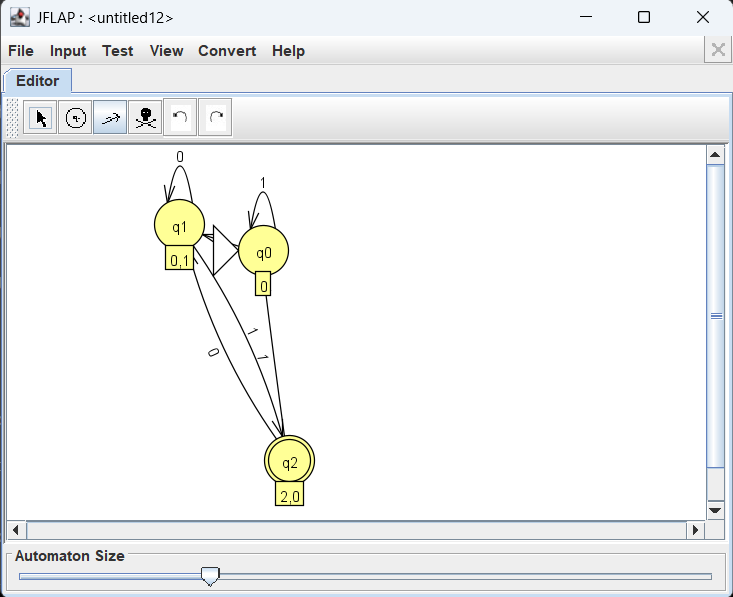
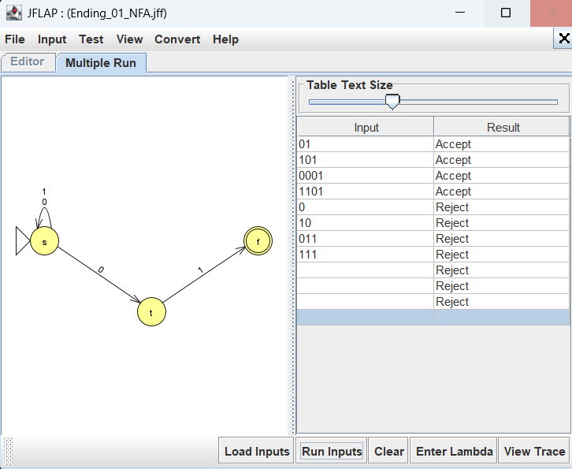

# Experiment 03: NFA to DFA Conversion

**Student:** Neilsen Vaz · **Roll No.:** 63 · **Class/Division:** T.E. Computer Engineering / D12A · **Semester:** V · **AY:** 2026–2027 · **Subject Code:** 26CMPC51

## Objective and model

Convert the NFA for binary strings ending in `01` by subset construction (Convert → Convert to DFA in JFLAP). The converted subset DFA accepts exactly the same language.

## Files

- [63_Neilsen_Vaz_NFA_to_DFA_Original_NFA_10-11-2026.jff](63_Neilsen_Vaz_NFA_to_DFA_Original_NFA_10-11-2026.jff)
- [63_Neilsen_Vaz_NFA_to_DFA_Converted_DFA_10-11-2026.jff](63_Neilsen_Vaz_NFA_to_DFA_Converted_DFA_10-11-2026.jff)
- [63_Neilsen_Vaz_NFA_to_DFA_11-11-2026.jff](63_Neilsen_Vaz_NFA_to_DFA_11-11-2026.jff) — *Converted DFA saved from JFLAP subset construction on 11-11-2026*

## JFLAP procedure

1. Open JFLAP 7.1.
2. Open the original NFA with **File → Open**.
3. Use **Convert → Convert to DFA** to perform subset construction step-by-step or automatically.
4. Export/save the converted DFA to a new file (`63_Neilsen_Vaz_NFA_to_DFA_11-11-2026.jff`).
5. Use **Input → Multiple Run** to test identical inputs on both machines and confirm equivalence.

## Test inputs and observed behavior

All 8 test cases passed with matching results:

| Input | Expected behavior | Original NFA Result | Converted DFA Result |
|---|---|---|---|
| `01` | Accept | Accept | Accept |
| `101` | Accept | Accept | Accept |
| `0001` | Accept | Accept | Accept |
| `1101` | Accept | Accept | Accept |
| `0` | Reject | Reject | Reject |
| `10` | Reject | Reject | Reject |
| `011` | Reject | Reject | Reject |
| `111` | Reject | Reject | Reject |

## Verification status

Automated XML parsing, structural validation, and JFLAP GUI verification are all complete. The subset construction was executed in JFLAP 7.1, the resulting converted DFA model was saved, and all 8 test cases were verified in the GUI.

## GUI Verification

- `63_Neilsen_Vaz_NFA_to_DFA_Original_NFA_10-11-2026.jff` — ✅ GUI-tested via Multiple Run; all 8 test cases passed.
- `63_Neilsen_Vaz_NFA_to_DFA_11-11-2026.jff` — ✅ Converted via JFLAP subset construction and verified.

### Screenshots

#### Converted DFA (Subset Construction in JFLAP)

#### Original NFA Multiple Run Test

