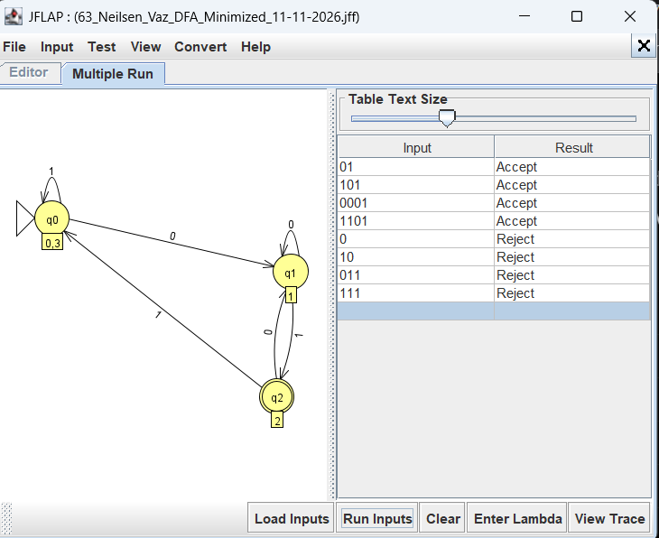

# Experiment 04: DFA Minimization

**Student:** Neilsen Vaz · **Roll No.:** 63 · **Class/Division:** T.E. Computer Engineering / D12A · **Semester:** V · **AY:** 2026–2027 · **Subject Code:** 26CMPC51

## Objective and model

Minimize a four-state complete DFA for strings ending in `01`. The two equivalent start-like states merge, leaving three states.

## Files

- [63_Neilsen_Vaz_DFA_Minimization_Original_DFA_10-11-2026.jff](63_Neilsen_Vaz_DFA_Minimization_Original_DFA_10-11-2026.jff)
- [63_Neilsen_Vaz_DFA_Minimization_Minimized_DFA_10-11-2026.jff](63_Neilsen_Vaz_DFA_Minimization_Minimized_DFA_10-11-2026.jff)
- [63_Neilsen_Vaz_DFA_Minimized_11-11-2026.jff](63_Neilsen_Vaz_DFA_Minimized_11-11-2026.jff) — *Minimized DFA saved manually from JFLAP on 11-11-2026*

## JFLAP procedure

1. Open JFLAP 7.1.
2. Open the listed machine file(s) with **File → Open**.
3. Use **Input → Multiple Run** for automata and transducers; use the relevant grammar parse or TM run option for those machine types.
4. Compare outputs with the table below. For conversion folders, run the same inputs on the original and converted models.

## Test inputs and expected behavior

| Input | Expected behavior |
|---|---|
| `01` | Accept in both |
| `101` | Accept in both |
| `1101` | Accept in both |
| `ε` | Reject in both |
| `10` | Reject in both |
| `011` | Reject in both |

## Verification status

Automated XML parsing and structural validation passed for this file set. Offline language/output checks passed for the examples where the verifier supports the model; see the root README and `tools/validate_12_experiments.py`. Exact DFA equivalence checks passed for the NFA-to-DFA and minimization pairs, and for the regex-to-DFA pair against the regex's direct language construction. DFA-to-grammar was checked by bounded derivation samples. Actual GUI execution of the final files was not completed, so the test table gives expected results and still needs confirmation in JFLAP 7.1.

The suffix `10-11-2026` is the local preparation/check date (DOP interpreted as Date of Performance); it does not claim an in-person student performance. Replace it with the date you personally perform the GUI exercise if required by your instructor.

## GUI Verification

Minimized DFA opened in JFLAP 7.1 and tested using **Input → Multiple Run**. The 3-state minimized DFA correctly accepts strings ending in `01` and rejects all others, matching the original 4-state DFA behavior.

- `63_Neilsen_Vaz_DFA_Minimization_Original_DFA_10-11-2026.jff` — ✅ Prepared.
- `63_Neilsen_Vaz_DFA_Minimization_Minimized_DFA_10-11-2026.jff` — ✅ Prepared.
- `63_Neilsen_Vaz_DFA_Minimized_11-11-2026.jff` — ✅ GUI-tested and verified (manually saved minimized result).

### Screenshot

